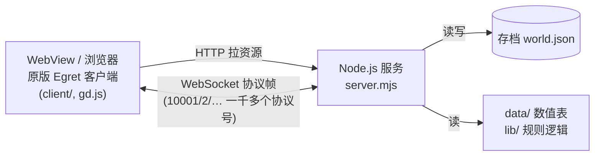
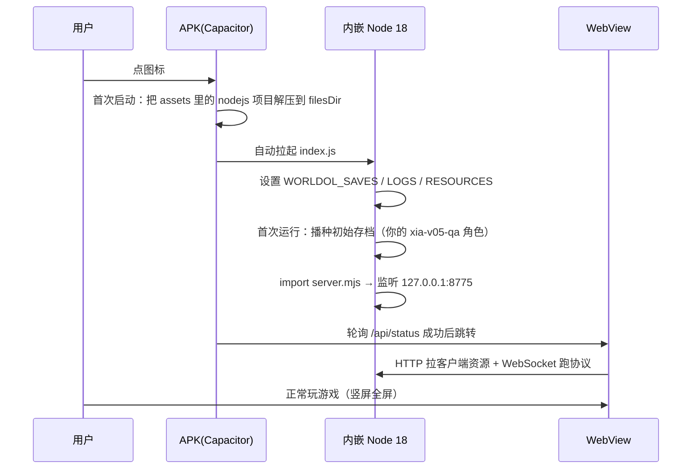

# 世界OL 单机版 → 安卓 APK 打包方案

> 面向 **世界OL_源码/世界online_原版单机**（v0.6.4，原版 v305 客户端）。

---

## 〇、当前方案：standalone（v0.7，已取代下文"内嵌 Node"方案）

**一句话**：不再往 APK 里塞 Node 运行时，而是把 `server.mjs` 用 esbuild 打成**一个 708 KB 的 JS 文件**，直接跑在 WebView 的 JS 引擎里；文件读写换成内存 VFS；WebSocket 换成内存直连；存档写 `localStorage`。

| | 第一代（内嵌 Node） | 第二代（standalone，现用） |
| --- | --- | --- |
| 服务端 | `nodejs-mobile` 跑真 Node | 同一份 `server.mjs`，esbuild 打进 WebView |
| 原生库 | `libnode.so` ×3，裁到 1 份仍占 60 MB | **无** |
| 首次启动 | 把 12 086 个文件从 assets 解压到私有目录 ≈ **10 分钟** | **零解压**，WebView 直接读 APK 内 assets |
| 实测首屏 | — | **2.4–3.5 秒**（预载 164 MB → 37 ms） |
| APK 体积 | 184 MB | 约 145–165 MB |
| NDK / CMake | 必需 | **不需要** |
| 存档 | App 私有目录的文件 | `localStorage`（卸载才清空） |

### 为什么要换

第一代真机启动要 **10 分钟**。根因在 `capacitor-nodejs`：它的 `CopyAssetDir` 是「无条件全量重拷」——`isAppUpdated()` 只管要不要先删，`CopyAssetDir` 每次都执行。12 086 个文件逐个 `assetManager.open()`，Android 上单文件几十毫秒，加起来就上去了。给插件打「跳过重复解压」补丁只能救第二次启动，冷启动第一次仍然漫长。

### 构建流程（两条命令）

```powershell
cd 安卓打包\standalone
node build.mjs                 # 生成站点到 app\www

cd ..
powershell -ExecutionPolicy Bypass -File .\构建APK.ps1 -Fresh
```

产物：`app\android\app\build\outputs\apk\debug\app-debug.apk`

`-Fresh` 只在**第一次**用（要摘掉旧 android 工程里的 `capacitor-nodejs` 模块引用），之后增量构建不用带。

### 目录

```
安卓打包\standalone\
  build.mjs        一键构建：铺站点 → 打客户端补丁 → 合并协议模块 → 生成启动页 → esbuild 打包
  entry.mjs        运行时入口（暴露 window.__worldolStandalone）
  boot.js          页面级启动编排（构建期内联进 index.html）
  globals.mjs      游戏侧模块的静态挂载点
  shims\           fs / path / url / crypto / vm / http / ws / intercept / vfs / buffer …
  自检shim.mjs     Node 侧 shim 自检（21 项）
```

替换掉的只有三个出口：**文件系统**（→ 内存 VFS）、**WebSocket**（→ 内存直连）、**存档持久化**。游戏逻辑、协议、数据一个字节没动。

### 端到端实测

```
5000  系统时间                            ✔
5002  本地账号                            ✔ → status「本地账号已就绪，可选择角色」
16021 / 16001 / 5007（角色列表，106 字节）  ✔
```

进世界后地图、NPC、任务栏、战力全部正常。

### 三个必须知道的坑

**1）`gd.js` 必须被注入两个调用。** 原 Node 版是 `server.mjs` 在响应 `/gd.js` 时改写：

```js
(a["gs"] = new n())              →  (window.offlineBootSettings(), a["gs"] = new n())
(s["startEgret"] = function () { →  (s["startEgret"] = function () { window.offlineInstall();
```

`window.offlineInstall()` 内部才会把 `gg.encodeMsg/decodeMsg` 从客户端原生的 `[uint16 长度][uint16 类型]` 换成本地服务端认的 `[int32 类型]`。

缺了它：客户端发 `00 16 13 88`，服务端按 4 字节读成 1446792 →「请先进入本地存档」→ `sendProtoAsync msg:5000 time out`，而且会去连正式服 `wss://sjh5server.good321.net:7003`。

**2）`build.mjs` 里 `layoutSite()` 必须排在最前面。** 它用 `fs.cpSync(client → outRoot)` 全量平铺，会**覆盖**掉后面写的 `gd.js` 和打过补丁的主包。顺序反了不报错，只是补丁静默失效。

**3）别全量预载 `data/`。** `data/` 有 160 MB，其中 `official-v305.json`(33 MB)、`content-library.json`(28 MB)、`recorded-content.json`(17 MB) 这类全是前端面板自己 `fetch` 的资料，服务端根本不读。全量预载让首屏白白多花 20 秒。现在 VFS 未命中时用**同步 XHR** 现场取一份并缓存，预载清单从 184 项 / 164.7 MB 降到 **3 项**。

### 调试提示

- 游戏启动后会**接管 `console`**，此后 `console.log` 进不了浏览器控制台。探针请写 `globalThis.*` 或 VFS 文件。
- 启动各阶段耗时：`window.__worldolBootTimings`
- 服务端会话日志：`window.__worldolStandalone.readText('/worldol/logs/session.jsonl')`
- 未命中文件清单：`window.__worldolStandalone.missList()`
- 本地预览：`node 工具\静态服务器.mjs app\www 18800`

---

> 以下为第一代（内嵌 Node）方案的记录，**已被上面的 standalone 方案取代**，保留作参考。

> 面向 **世界OL_源码/世界online_原版单机**（v0.6.4，原版 v305 客户端）。
> 本文是"先研究、后动手"的结论文档；配套脚本：

| 文件 | 作用 |
| --- | --- |
| `准备资源.ps1` | 从源码目录挑出「运行必需」的文件 + 存档，生成打包用的 `app/www/nodejs/` |
| `安装环境.ps1` | 安装 JDK 17 + Android SDK（一次性，约 2–3 GB） |
| `构建APK.ps1` | 生成 APK（`assembleDebug`，可直接安装） |
| `mobile/index.js` | 手机端的 Node 启动入口（由 `准备资源.ps1` 复制进包） |
| `工具/自检打包资源.mjs` | **不装 Android 环境也能跑**：直接加载打包后的 `server.mjs` 并探测关键接口，验证文件集有没有漏 |
| `app/` | Capacitor 工程骨架（网页外壳 + 配置） |

> **Capacitor 是不是必须的？** 不是。真正必须的是「WebView + 内嵌 Node 运行时」。
> Capacitor 只提供①Android 工程脚手架、②WebView 放行 `http://127.0.0.1` 的配置、
> ③`capacitor-nodejs` 插件完成 nodejs-mobile 的 JNI/CMake 集成与 assets 解压。
> 其中③是硬需求，但也可以换成 Cordova（插件更老，内嵌 Node 版本低，需改代码）
> 或纯原生工程自己写（约 200+ 行 Java/C++）。详见下文「六、动手步骤」后的对比。

---

## 一、为什么不能"直接打包成网页 App"

这个项目**不是纯前端**，它由两半组成：



- 客户端是 **Egret H5**（`index.html` 里的 `egret-player`，竖屏 720×1280），跑在浏览器/WebView 里。
- 但**几乎所有游戏逻辑在服务端**：`server.mjs` 会读取 `client/` 原版 bundle、打补丁、再用 WebSocket 跑协议；存档、任务、战斗结算、商店、技能、图鉴全在 `lib/*.mjs`。
- 所以 **APK 里必须能跑一个真正的 Node.js 进程**，只套个 WebView 是玩不了的（会卡在登录连不上）。

## 二、三种可行路线对比

| 方案 | 做法 | 优点 | 缺点 | 结论 |
| --- | --- | --- | --- | --- |
| **A. WebView + 内嵌 Node 运行时**<br/>（Capacitor + capacitor-nodejs） | 用 `nodejs-mobile`（Android 版 Node 18.20.4）在 App 内起 `server.mjs`，WebView 打开 `http://127.0.0.1:8775` | 不用改一行游戏逻辑；离线单机；真正一个 APK | APK 约 250 MB，安装后占用约 600 MB；构建环境要装 JDK17+Android SDK | ✅ **推荐** |
| B. Termux / 手机端 Node | 手机装 Termux，把源码放进去，`node server.mjs` 再开浏览器 | 零构建，最快能玩上 | 不是 APK；要敲命令；新手不友好 | 备选/临时方案 |
| C. 电脑当服务端，手机连 WiFi | 电脑跑 `启动当前角色.cmd`，手机浏览器开 `http://电脑IP:8779` | 一行不用改 | 必须开机、同网络，不是"随身玩" | 备选 |

> 还有一个"纯前端化"（把 `lib/*.mjs` 全部改写成浏览器内运行）的方案，工作量巨大且会破坏现有存档兼容性，**不建议**。

## 三、推荐方案 A 的完整链路



关键点：**存档写在 Android 给 App 的私有可写目录**（`filesDir`），升级 APK 不会丢；`client/ data/ lib/` 是只读资源，跟着 APK 走。

## 四、运行必需文件清单（已逐项核对源码得出）

我按代码里的真实读取路径核对过，**不是猜的**：

| 路径 | 大小 | 为什么必需 |
| --- | --- | --- |
| `server.mjs` | ~40 KB | 服务入口 |
| `lib/` | 0.3 MB | 全部规则逻辑（含 `client-*-patch.mjs` 客户端补丁链） |
| `web/` | 0.2 MB | `offline.js` 等单机界面脚本、`viewport.js` 触屏适配 |
| `client/` | **127.6 MB** | v305 原版资源（4685 png / 5322 json / 76 mp3）。`server.mjs` 第 64 行据此判断资源根 |
| `data/` | **159.8 MB** | `lib/*.mjs` 通过 `new URL('../data/xxx.json')` 直接读，共 20+ 个表 |
| `analysis/gd.decoded.js` | 35 KB | **必需**！`server.mjs` 第 74 行拿它当客户端引导脚本模板（`/gd.js` 就是它） |
| `analysis/modules/**` | **5.6 MB**（1613 个文件） | **必需**！`server.mjs` 第 254 行从 `0019.js` 解析协议号表；`tools/capture-decoders.mjs` 还会**按协议号懒加载**其余模块，所以整目录都要带上 |
| `tools/capture-decoders.mjs` | 8 KB | **必需**！被 `lib/` 下 8 个模块 import（legion / daily / spirit-seal / illusion / home-feature / pet-equipment / feature-protobuf / native-character-stats） |
| `node_modules/ws` | 0.1 MB | WebSocket 服务 |
| `node_modules/acorn` + `acorn-walk` | 0.6 MB | `lib/client-combat-limits.mjs` 和 `tools/capture-decoders.mjs` 运行时解析客户端代码 |
| `saves/` + `qa-v05-saves/` | 1.4 MB | 你的存档（会作为"初始存档"打进包） |
| **合计** | **≈ 296 MB / 12085 个文件** | |

**明确不需要**（可以省 100 MB+）：`runtime/`（Windows 版 node.exe，88.5 MB）、`node_modules/prettier`（仅开发工具用）、`tools/` 里除 `capture-decoders.mjs` 以外的开发脚本、`tests/`、`backups/`、`logs/`、`analysis/` 里除上面两项以外的内容。

> ### ✅ 已实际构建成功（2026-10-01）
> 产物：`app\android\app\build\outputs\apk\debug\app-debug.apk`，**184 MB**。
> 内置 `libnode.so` 仅 arm64-v8a 一份（默认），如需兼容旧机/模拟器：
> `-Abi all`（约 306 MB）或 `-Abi armeabi-v7a` / `-Abi x86_64`。
>
> 体积构成（APK 内）：`lib/` 62 MB（不压缩） + `client/` 96 MB + `data/` 17 MB + 其他 9 MB。

> 体积预估：APK ≈ **184 MB**（PNG/MP3 已压缩，JSON 被 aapt2 压到约 1/9）；
> 首次启动解压后 App 占用 ≈ **480 MB**。
>
> ⚠️ `tools/capture-decoders.mjs` 和 `analysis/modules/` 这两个依赖是用 `工具\自检打包资源.mjs`
> 冒烟测试跑出来的——第一版清单里漏了它们，`server.mjs` 会直接 `ERR_MODULE_NOT_FOUND` 起不来。
> **改动清单后请务必重跑自检。**

## 五、已核对的「手机上能不能跑」清单

我逐条对照 `nodejs-mobile`（Node 18.20.4）的 Android 限制检查了本项目：

| 限制 | 本项目情况 | 结论 |
| --- | --- | --- |
| 不能 `child_process` | `lib/`、`server.mjs` 均未使用 | ✅ |
| 无 `Intl` | `lib/` 内无 `Intl.`/`toLocaleString`/`localeCompare` | ✅ |
| 无原生扩展（`.node`） | 只用 `ws`/`acorn`/`acorn-walk`，纯 JS | ✅ |
| `fs` 不能建硬链接 | `store.mjs` 只用 `renameSync` / `copyFileSync`（本次包用的是**保存到可写目录**，正常） | ✅ |
| ESM (`"type":"module"`, `.mjs`) | Node 18 完整支持 | ✅ |
| 触屏 / 竖屏 | `web/viewport.js` 已做画布坐标换算；客户端本身是 720×1280 竖屏 | ✅ |
| WebSocket 明文 | 服务端 `verifyClient` 只认 `http://127.0.0.1:端口` 来源，正好匹配 WebView | ✅ |
| `iframe` | 服务端 CSP 是 `frame-src 'none'`，**不能用 iframe 套**，只能整页跳转 | ⚠️ 已在 `app/www/index.html` 里处理 |

## 六、动手步骤

```powershell
# 0. 若当前目录就是本文件夹
cd 世界OL_源码\安卓打包

# 1. 生成打包用资源（约 296 MB，几秒钟）
powershell -ExecutionPolicy Bypass -File .\准备资源.ps1

# 1.5 【强烈建议】自检：不用 Android 环境就能确认文件集完整
node .\工具\自检打包资源.mjs
#   期望输出末尾：全部通过：最小文件集完整。
#   若报 ERR_MODULE_NOT_FOUND，说明 准备资源.ps1 的文件清单又漏了东西，
#   把那行报错里的路径补进 准备资源.ps1 再重跑。

# 2. 安装构建环境（一次性，约 2.7 GB；不需要管理员）
powershell -ExecutionPolicy Bypass -File .\安装环境.ps1

# 3. 出 APK（首次约 4–15 分钟；成品默认 arm64-v8a）
powershell -ExecutionPolicy Bypass -File .\构建APK.ps1
#   产物：app\android\app\build\outputs\apk\debug\app-debug.apk（184 MB）
```

### 常用参数

| 参数 | 用途 |
| --- | --- |
| `-Abi all` | 同时包含 arm64-v8a + armeabi-v7a + x86_64（约 306 MB），兼容老机与模拟器 |
| `-Abi armeabi-v7a` / `-Abi x86_64` | 只出指定架构 |
| `-Fresh` | 删掉 `app\android` 重新生成（改了 `appId` 或插件后使用） |
| `-NoImmersive` | 不注入沉浸式全屏 |
| `-Release` | 出 release 包（需自行配签名） |

装到手机：`adb install -r app-debug.apk`，或把 APK 拷进手机点击安装（需允许"未知来源"）。

## 九、构建踩坑实录（都是实际踩过并已修复的）

| # | 现象 | 原因 | 已落地的修复 |
| --- | --- | --- | --- |
| 1 | `listen EACCES` | Windows 保留端口段（`netsh interface ipv4 show excludedportrange protocol=tcp`，本机含 8880–8979） | 自检脚本默认改用 18775 |
| 2 | 脚本报「缺少右 `}`」 | PowerShell 5.1 只认 **带 BOM** 的 UTF-8 `.ps1` | 写完脚本补 BOM |
| 3 | `无法覆盖变量 Home` | `$Home` 是 PowerShell 只读内置变量 | 参数改名 |
| 4 | `javac`/`sdkmanager` 输出把脚本带崩 | `$ErrorActionPreference='Stop'` 下原生命令写 stderr 被当致命错误 | 改为 `'Continue'` + 逐条检查 `$LASTEXITCODE` |
| 5 | Gradle 下载超时 | `services.gradle.org` 国内连不上 | 换成 `mirrors.cloud.tencent.com/gradle/` |
| 6 | 依赖拉取慢/失败 | `dl.google.com` 慢 | `build.gradle` 注入阿里云 Maven 镜像 |
| 7 | `Your project path contains non-ASCII characters` | 目录名含「源码 / 世界OL_源码 / 安卓打包」 | `gradle.properties` 加 `android.overridePathCheck=true` |
| 8 | `Unexpected character: '\uFEFF'` 编译 `build.gradle` 失败 | 插件自带的 `.gradle` 带 BOM | 构建前自动剥掉 `node_modules` 下 `.gradle` 的 BOM |
| 9 | `javac: 非法字符: '\ufeff'` | 我用 `Set-Content -Encoding UTF8` 写入的 `MainActivity.java` 带 BOM | 关键文件一律 `[IO.File]::WriteAllText(..., UTF8Encoding($false))` |
| 10 | 日志看起来是乱码（如 `婧愮爜`） | 子进程按 GBK 输出、Tee 按 UTF-16 写，混编 | 构建脚本设 `[Console]::OutputEncoding = UTF-8` |
| 11 | APK 达 308 MB | 三份 `libnode.so`（arm64 60 MB + armv7 58 MB + x86_64 64 MB）全打进包 | 默认 `-Abi arm64-v8a`，瘦到 184 MB |

## 七、已知风险 / 注意点

1. **首次启动慢**：要把 296 MB 从 APK 解压到私有目录，中低端机可能 30–90 秒。启动页会显示进度，请耐心等待，不要反复杀进程。
2. **Node 18 已 EOL**：`nodejs-mobile` 上游已停止维护（作者已把 capacitor-nodejs 标为"不推荐新项目"），但对这种离线单机游戏完全够用，且是目前唯一"不用自己编 NDK"的成熟路线。
3. **不要卸载重装**：存档在 App 私有目录，卸载会清掉。可用 `app/www/nodejs/initial-saves/` 作为兜底重新播种。
4. **首次构建可能较久**：12,000+ 个小文件过 aapt2 会比较慢（首次 5–15 分钟）。若失败，见下面「优化」。
5. **iOS 不支持**：本方案只做 Android。

### 优化（如果构建因文件数过多而失败）

- 只保留真正用到的客户端资源；或
- 把 `client/` 用 `zip -0`（不压缩，避免二次压缩）打成一个包，启动时解压——需要额外写解压代码，属于第二阶段优化。

## 八、备选方案 B 的操作（今天就能玩，不用等构建）

1. 手机装 **Termux**（F-Droid 版）。
2. 把 `世界online_原版单机/` 整个目录拷到手机。
3. Termux 里：
   ```bash
   pkg install nodejs-lts
   cd /sdcard/世界online_原版单机
   WORLDOL_PORT=8775 node server.mjs
   ```
4. 手机浏览器打开 `http://127.0.0.1:8775/?save=xia-v05-qa`。

这个方式当天就能玩，可以用来**先验证手机 WebView/浏览器跑不跑得动**，再决定要不要花时间出 APK。
