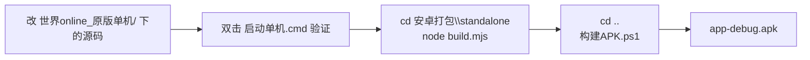

# 改 BUG / 调功能 → 重新出 APK 全流程

> 这份文档写给「以后不开 AI 也能自己动手」的场合。
> 只需要记住一句话：**`lib/` 是唯一一份源码，电脑版和手机版都从它取，所以只改一遍。**

---

## 0. 总览



**关键点**：电脑版是「服务端在运行时把补丁打到客户端」，APK 版是「构建时把同一批补丁打进去」。
两边的补丁来源是**同一批 `lib/client-*-patch.mjs` 文件**，所以你改一处，两边都受益。

---

## 1. 改哪里 —— 目录地图

整个工程就两个目录要塞在脑子里：

```
世界OL_源码/
├── 世界online_原版单机/     ← 源码（要改的都在这里）
│   ├── server.mjs           服务端入口 + 协议分发
│   ├── lib/                 ★ 游戏逻辑（90 个模块，最常改的就是这里）
│   ├── web/                 独立版界面（单机菜单、面板、按钮）
│   ├── data/                前端资料表（图鉴/技能表/宠物表…，界面显示用）
│   ├── analysis/            分析产物（客户端引导脚本 + 拆包参考）
│   ├── client/              ★ H5 客户端（压缩过的产线包，别直接改）
│   └── saves/ qa-v05-saves/ …  各套存档
│
└── 安卓打包/                ← 打包用
    ├── standalone/build.mjs   构建脚本（生成网站站点）
    ├── app/www/               站点产物（自动生成，别手改）
    ├── 构建APK.ps1           出 APK
    └── 说明.md               打包细节文档
```

| 你想改什么 | 改哪个文件 | 备注 |
| --- | --- | --- |
| 怪物强度、掉率、经验、数值 | `lib/monster-balance.mjs`、`lib/loot.mjs`、`lib/player-experience.mjs` | 纯数值表，最好改 |
| 某个功能不对（技能/商店/装备/宠 物） | `lib/` 下同名模块，如 `pet-service.mjs`、`equipment-upgrade-service.mjs` | 看名字找 |
| 协议收发、登录、选角、协议号 | `server.mjs`（约 170 行往下是一长串 `if(type===xxx)`) | |
| **客户端**的界面、提示、计算 | `lib/client-*-patch.mjs`（**写补丁**，见例 3） | 不要直接改 client/ |
| 单机菜单、面板、按钮、存档 UI | `web/offline.js`（+ `web/index.html` 改结构） | |
| 图鉴 / 技能表里显示的**资料** | `data/*.json` | 界面直接 fetch |
| 存档格式、账号逻辑、角色上限 | `lib/store.mjs` | 改之前先备份存档 |
| 新手任务、开服礼包 | `lib/newbie-service.mjs`、`lib/newbie-missions.mjs` | |
| 每日任务、日常活动 | `lib/daily-service.mjs`、`lib/task-reset.mjs` | |

> 拿不准改哪个：在 VS Code 里按 `Ctrl+Shift+F` 全选目录搜关键词（比如「掉率」「强化」「宠物」），
> 大概率就能搜到 `lib/` 里的那个模块。

---

## 2. 三条铁律（踩过的坑）

### ① 不要直接改 `client/js/ff/fff570bb4753f056432680e781d827dc.js`

那是压缩成一行的产线包，而且 **APK 构建时会被重新平铺覆盖**（覆盖顺序在 `build.mjs` 里有讲究），
你改了也会没。

正确做法：在 `lib/` 下写一个**补丁函数**（字符串替换），让服务端/构建期去改它。见例 3。

### ② 客户端补丁必须两边都挂

补丁函数是「输入客户端源码字符串 → 输出改过的字符串」。它有两个调用点：

| 位置 | 作用 | 什么时候生效 |
| --- | --- | --- |
| `server.mjs` 第 74–81 行 | 电脑版：请求 `/gd.js`、`/js/ff/<主包>` 时动态打补丁 | 重启服务端 |
| `standalone/build.mjs` 第 17–25 行 + `buildPatchedClient()` | APK 版：构建时把补丁写进 `app/www/` | 重跑 `node build.mjs` |

**改现有补丁**（只动函数体）：两边自动同步，不用管。
**新增一个补丁**：必须**两处都加**，而且顺序要一致，否则电脑版和手机版行为不一样。

### ③ 补丁锚点不匹配会直接报错 —— 这是好事

补丁里都是这种写法：

```js
if (source.split(from).length !== 2) throw Error('v305 damage patch mismatch: ' + kind);
source = source.replace(from, to);
```

故意保证「找不到就炸」。所以你升级了客户端产线包、锚点对不上了，会**立刻看到明确报错**，
而不是悄悄不生效。

---

## 3. 电脑版：怎么改、怎么跑、怎么看

### 启动入口

| 双击 | 端口 | 存档目录 | 默认存档名 | 用途 |
| --- | --- | --- | --- | --- |
| `启动单机.cmd` | 8775 | `saves/` | `offline` | 日常玩 |
| `继续测试角色.cmd` | 8776 | `test-saves/` | `acceptance` | 测试用 |
| `体验原版内容.cmd` | 8776 | `test-saves/` | `original-v04` | 体验原版 |
| `停止单机.cmd` | | | | 关掉服务 |

想直接开 `qa-v05-saves`（那 5 个 97 级角色）在 `世界online_原版单机\` 下跑：

```powershell
powershell -NoProfile -ExecutionPolicy Bypass -File .\start.ps1 -Port 8779
```

（端口和存档目录的对应关系写在 `launcher-common.ps1` 第 3–4 行）

### 改完怎么让它生效

| 改的是 | 生效方式 |
| --- | --- |
| `lib/` 里的服务端模块 | 双击 `停止单机.cmd`，再重新 `启动单机.cmd` |
| `server.mjs` | 同上 |
| `web/` 下的界面 | 浏览器直接 `F5` 刷新 |
| `data/` 下的 JSON | 浏览器刷新 |
| `lib/client-*-patch.mjs` | 重启服务端（因为是服务端在打补丁） |

### 出问题了看哪里

- **服务端日志**：`世界online_原版单机\logs\session.jsonl`（每个端口一个子目录）
  每行一条 JSON，`"kind":"send"/"receive"` 就是协议收发。
- **服务端崩溃**：同目录 `server-8779.stderr.log`
- **浏览器**：`F12` 看控制台。
  ⚠️ 但**游戏启动后会接管 `console`**，之后的 `console.log` 不会出现在控制台里。
  调试用 `alert()`，或者写进页面上的「单机菜单 → 诊断记录」。

---

## 4. 四个照着改的例子

### 例 1：改怪物强度（纯数值，最好改）

文件：`lib/monster-balance.mjs`

```js
// Local gameplay tuning, separate from the preserved official recordings.
export const monsterBalance = { 1985: { hp: 10, stats: 1 } };
```

意思是：怪物 id `1985` 的血量 ×10，其余属性 ×1。

- `hp` → 只乘血量
- `stats` → 乘其它所有属性

想让 1985 血量 ×50、其余 ×2：

```js
export const monsterBalance = { 1985: { hp: 50, stats: 2 } };
```

想加第二只：`{ 1985: {...}, 2001: { hp: 20, stats: 1 } }`

> 注意：这个文件里有上下限保护，改太大会直接抛
> `Monster 1985 hpMax exceeds native int`，看到就是改过头了。

### 例 2：改服务端功能逻辑

先定位到协议号，再定位到代码：

1. 在电脑版里操作那一步（比如点某个按钮），
2. 打开 `logs/session.jsonl`，看最后几行的 `"kind":"send","type":xxxxx`，
3. 在 `server.mjs` 里搜 `type===xxxxx`，就找到处理它的分支了：

```js
if(type===5002){context.account=store.account(r.string()); ...}
if(type===10001)return send(type,roleListPacket(store,context.account));
```

如果是「处理逻辑」而不是「协议解析」，那个分支通常会调 `lib/` 里的某个函数，
顺着 import 找过去就是真正要改的地方。

### 例 3：改客户端（写补丁函数）

**场景**：想改的是客户端的表现或计算，比如伤害公式。

**第一步**，找到一个同类补丁抄格式。`lib/client-damage-patch.mjs` 全文：

```js
export const damageMathRevision='wide-product-v1';

export function patchBattleDamageMath(source){
  const products=[
    ['slashing','h=g.GUtil.intNum((100-u)*_*d)','h=Math.trunc((100-u)*_*d)'],
    ['piercing','N=g.GUtil.intNum((100-P)*R*O)','N=Math.trunc((100-P)*R*O)'],
    ['magic','D=g.GUtil.intNum((100-w)*b*x)','D=Math.trunc((100-w)*b*x)']
  ];
  for(const [kind,from,to] of products){
    if(source.split(from).length!==2)throw Error('v305 damage patch mismatch: '+kind);
    source=source.replace(from,to);
  }
  return source;
}
```

**第二步**，怎么找到要替换的那段字符串？

1. 浏览器里打开游戏，`F12` → Sources，找到客户端主包（一长行）。
2. 用 `Ctrl+F` 搜关键词（比如提示文字、属性名），把它周边的一小段**唯一**的代码抄下来。
3. 那就是 `from`。把 `to` 写成你改过的版本。

**第三步**，挂上去。新建 `lib/client-mypatch.mjs`，然后：

- `server.mjs`：import 进来，加进第 79–81 行那串嵌套调用里
- `standalone/build.mjs`：import 进来，加进 `buildPatchedClient()` 的同一串嵌套调用里

两处顺序必须一样。

> 更省事的做法：**直接改现有的补丁文件**（比如往 `client-damage-patch.mjs` 里多加一条替换规则），
> 这样就自动两边生效，不用动 `server.mjs` 和 `build.mjs`。

### 例 4：改单机菜单 / 界面

文件：`web/offline.js`（逻辑）+ `web/index.html`（结构）

- 加按钮：在 `index.html` 的 `<div class="actions">` 里加一个 `<button id="xxx-open" disabled>名字</button>`，
  然后在 `offline.js` 里 `document.getElementById('xxx-open').onclick = ...`
- 改公告文字：搜 `applyNotice`，那里是逐行数组，直接改字符串。
  注意配色标记的写法（注释里写了规则）：`/cRRGGBB文字/p`
- 改独立版顶部状态提示：搜 `record(`

> APK 版里 `web/index.html` 会由 `build.mjs` 改写后输出到 `app/www/index.html`
> （去掉几段动态脚本、加回启动脚本）。所以**改源文件 `web/index.html`，不要改 `app/www/index.html`**。

---

## 5. 改完怎么同步到 APK

**两条命令，就这两条：**

```powershell
cd 安卓打包\standalone
node build.mjs

cd ..
powershell -ExecutionPolicy Bypass -File .\构建APK.ps1
```

产物在：

```
安卓打包\app\android\app\build\outputs\apk\debug\app-debug.apk
```

- 第一次打包（或者改了 `app/capacitor.config.json` 的 `appId`）要加 `-Fresh`：
  `.\构建APK.ps1 -Fresh`
- 以后再打包都**不用**加 `-Fresh`，增量构建快很多。
- 出 APK 大约 5–15 分钟，构建日志在 `安卓打包\build.log`。

装到手机：

```powershell
adb install -r "安卓打包\app\android\app\build\outputs\apk\debug\app-debug.apk"
```

或者把 APK 拷进手机点安装（需允许「未知来源」）。

### `node build.mjs` 到底做了什么

1. 把 `client/` 平铺到 `app/www/`（站点根）
2. **应用客户端补丁链**，覆盖写出打过补丁的 `gd.js` 和主包
3. 把 `analysis/modules/*.js` 合成一个 JSON
4. 生成预载清单 `standalone-files.json`
5. 用 esbuild 把 `server.mjs` + `lib/` 打成单文件 `app/www/worldol-standalone.js`

所以只要改的东西在 `lib/`、`server.mjs`、`web/`、`data/`、`client/` 里，重跑它就会带上。

---

## 6. 出错了怎么退回去

| 情况 | 怎么办 |
| --- | --- |
| 改完游戏起不来 | 把刚才改的文件改回去（VS Code 的 `Ctrl+Z`，或者 `文件 → 放弃更改`） |
| 补丁报 `xxx patch mismatch` | 锚点字符串没匹配上。要么是你抄错了，要么产线包换了。搜索那段特征字符串核对 |
| `node build.mjs` 报错 | 看第一行报错信息，通常是某个 `replaceOnce` 锚点不匹配 |
| APK 构建失败 | 看 `安卓打包\build.log` 最后 30 行 |
| 存档坏了 | 想恢复就用「存档」按钮导入之前的备份；电脑版看 `backups\updates\` |

**改之前先复制一份**：要改的文件右键 → 复制 → 粘贴，改坏了随时能换回来。
存档同理，先拷一份 `world.json` 出来。

---

## 7. 速查表

```powershell
# ── 电脑版 ─────────────────────────────────────
双击 启动单机.cmd               # 端口 8775，存档 saves/
双击 继续测试角色.cmd            # 端口 8776，存档 test-saves/
双击 停止单机.cmd               # 停止服务
# 看日志
世界online_原版单机\logs\session.jsonl

# ── 出 APK ────────────────────────────────────
cd 安卓打包\standalone
node build.mjs                              # 1~2 秒
cd ..
powershell -ExecutionPolicy Bypass -File .\构建APK.ps1
# 产物：安卓打包\app\android\app\build\outputs\apk\debug\app-debug.apk

# ── 本地预览站点（不装手机，先在浏览器看 APK 版效果）──
cd 安卓打包
node 工具\静态服务器.mjs app\www 18800
# 然后浏览器打开 http://127.0.0.1:18800/

# ── 存档互换 ──────────────────────────────────
# 电脑版存档：世界online_原版单机\qa-v05-saves\world.json
# 手机版存档：游戏里点右下角「存档」按钮 → 导出存档 / 导入存档
# 两边格式完全一样，可以直接互导
```

**手机版专用调试信息**（在手机浏览器/WebView 里不好开控制台，所以留了全局变量）：

```js
window.__worldolBootTimings                        // 启动各阶段耗时
window.__worldolStandalone.readText('/worldol/logs/session.jsonl')  // 服务端日志
window.__worldolStandalone.missList()              // 没找到的文件
```

---

## 附：常见问题

**Q：改完电脑版有效，APK 没变？**
A：忘了 `node build.mjs`。`构建APK.ps1` 只是把 `app/www` 打进 APK，
它不会去读 `lib/` 的源码。

**Q：改了 `client/` 下的东西但没效果？**
A：`client/` 里的主包和 `gd.js` 会被构建期补丁覆盖。要么写补丁（例 3），
要么改 `analysis/gd.decoded.js`（那是 `/gd.js` 的真正来源）。

**Q：能不能只改 APK 版、不动电脑版？**
A：可以，但没必要。`lib/` 就是一份，两边一起改掉更好维护。

**Q：改了 `app/www/` 里的文件为什么没用？**
A：那是产物目录，每次 `node build.mjs` 会**整个删掉重建**。改源头。

**Q：`.ps1` 脚本改了运行报错？**
A：PowerShell 5.1 只认**带 BOM** 的 UTF-8 `.ps1`。用 VS Code 保存时选
「UTF-8 with BOM」。
反过来，`.gradle` / `.java` / `.properties` **不能**带 BOM，否则编译报
`Unexpected character: '\uFEFF'`。
